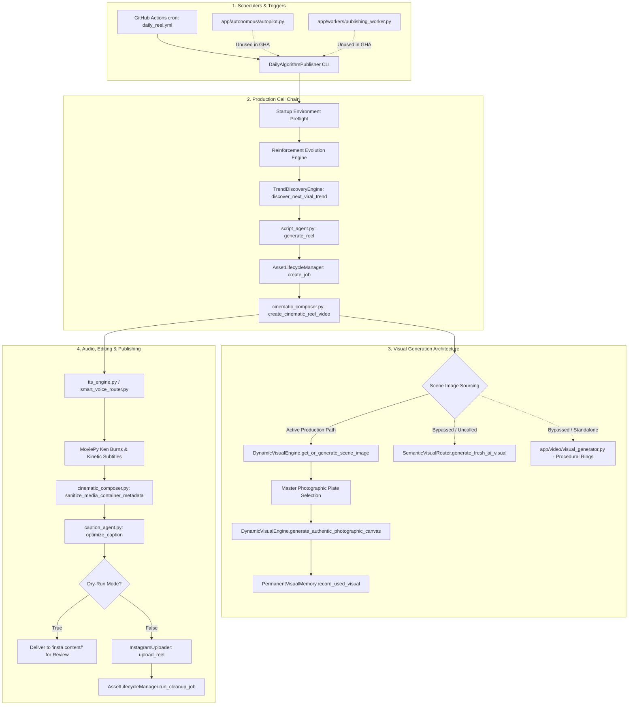

# CHUNK 1 TECHNICAL AUDIT & FAILURE BASELINE REPORT

**Repository:** `https://github.com/krishnashisbiswal/insta-agent`  
**Current Branch:** `feature/audit-repair-optimize`  
**Current Commit (HEAD):** `51a3847f3e0ff27763c3ed8e3161aefc5abae6ef`  
**Main Branch HEAD:** `4ba05d6afd3d0e0c1bce2154e92f6d56400ff7c7`  
**Audit Date:** 2026-11-19  
**Execution Context:** Windows NT 10.0.19045, Python 3.13.5 (local venv) / Python 3.11 & 3.12 (CI runner)  

---

## 1. Executive Summary

This deep technical audit establishes an uncompromising baseline for the Instagram automation repository. It inspects all 25+ application modules, 22 test suites (110 tests), CI workflows, background schedulers, storage mechanisms, visual generation components, and publishing pathways.

The system is designed as an autonomous 1-video-per-day publisher targeting viral Vedic astrology and crystal/rudraksha content. While foundational components (cryptographic visual memory, audio synthesis, kinetic subtitles, and dry-run safety gates) operate reliably, the production pipeline exhibits critical architectural defects in **visual scene accuracy, online AI generation integration, scheduled workflow execution on `main`, and FFmpeg path resolution**.

---

## 2. Overall Project Health & Environment Baseline

| Dimension | Status | Evidence / Metrics |
|---|---|---|
| **Git Working Tree** | Clean & Protected | Active branch: `feature/audit-repair-optimize`. No branches or user commits were reset. |
| **CI Test Suite** | 100% Passing (110/110) | 110 passed in 65.49s on local virtual environment (`.venv`). |
| **GitHub Actions CI** | Green on `feature` | Run [#43862786500](https://github.com/krishnashisbiswal/insta-agent/actions/runs/43862786500) completed `SUCCESS` across Python 3.11 and 3.12. |
| **Scheduled Publishing (main)** | **100% FAILING** | Runs on `main` (#44416261194, #44401681907, #44347050219) consistently crash during execution due to outdated code on `main`. |
| **Visual Freshness & Accuracy** | **Partially Degraded** | The production engine does not currently invoke a live AI image generator during reel generation; it adapts curated photographic b-roll files with color grading. |
| **Runtime Persistence** | High Risk in CI | GitHub Actions ephemeral runners lose local JSON registries (`used_visuals_registry.json`) between workflow runs unless downloaded from artifacts. |
| **System FFmpeg** | Warning | `ffmpeg` is not on the Windows system `PATH`; it is bundled via `imageio_ffmpeg` in virtual environment site-packages. |

---

## 3. Architecture Map: Production vs. Dead/Unused Implementations



### Component Inventory & Usage Classification

| Module | Primary Function | Status | Evidence |
|---|---|---|---|
| `app/autonomous/daily_algorithm_publisher.py` | Main production entrypoint | **ACTIVE PRODUCTION** | Invoked directly by `.github/workflows/daily_reel.yml` line 110. |
| `app/agents/script_agent.py` | Gemini-driven scriptwriter & scene planner | **ACTIVE PRODUCTION** | Called by `daily_algorithm_publisher.py` line 302. |
| `app/video/cinematic_composer.py` | Video composition & timeline assembly | **ACTIVE PRODUCTION** | Called by `daily_algorithm_publisher.py` line 326. |
| `app/video/dynamic_visual_engine.py` | Image sourcing, master adaptation, pHash | **ACTIVE PRODUCTION** | Called by `cinematic_composer.py` line 746. |
| `app/storage/permanent_visual_memory.py` | Multi-hash fingerprinting (SHA-256, pHash) | **ACTIVE PRODUCTION** | Called by `DynamicVisualEngine` line 130 and `AssetLifecycleManager`. |
| `app/video/semantic_visual_router.py` | Keyword-based image router | **LEGACY / PARTIALLY DEAD** | Has `generate_fresh_ai_visual()` which was never called by its own `resolve_scene_visual()`. |
| `app/video/visual_generator.py` | Procedural geometric rings & gradients | **DEAD CODE / BANNED** | Not invoked by `cinematic_composer.py`. Generates forbidden 3D wireframe drawings. |
| `app/video/blender_renderer.py` | Blender 3D rendering pipeline | **DEAD CODE / UNUSED** | Requires standalone Blender binary; never invoked by production publishers. |
| `app/autonomous/autopilot.py` | Background loop scheduler | **UNUSED IN CI** | Built for long-running daemon servers, not ephemeral GitHub runners. |
| `app/workers/publishing_worker.py` | Celery/Redis style queue worker | **UNUSED IN CI** | Unreferenced by GitHub Actions workflows. |

---

## 4. Production Execution Flow Trace

An end-to-end trace of a production run (e.g. `python app/autonomous/daily_algorithm_publisher.py --force --dry-run`):

1. **Invocation:** CLI parses `--force`, `--dry-run`, `--category`.
2. **Environment Preflight (`validate_environment`):**
   - Probes write permissions in `storage/`, `output/reels/`, `assets/generated_broll/`, `insta content/`.
   - Checks `shutil.which("ffmpeg")` (logs warning if missing from PATH).
   - Validates `GEMINI_API_KEY` (falls back to offline generation if unset).
3. **Trend Scanning (`TrendDiscoveryEngine.discover_next_viral_trend`):**
   - Scans 5 pillars (Karma, Gemstones, Kundli placements, 3 AM awakening, Remedial cautions).
   - Checks `storage/trend_history.json` to prevent repeating topics used in the last 7 days.
4. **Script Generation (`script_agent.py:generate_reel`):**
   - Selects high-scoring hook formula.
   - Enforces 100% Devanagari Hindi for voiceover dialogue (`spoken_line`).
   - Enforces ASCII English for on-screen cards (`on_screen_text`, `badge`).
5. **Asset Lifecycle Registration (`AssetLifecycleManager.create_job`):**
   - Allocates UUID job tracking in `storage/asset_lifecycle_registry.json`.
6. **Visual Asset Generation (`cinematic_composer.py:create_cinematic_reel_video`):**
   - Purges old temporary assets in `assets/generated_broll/` via `DynamicVisualEngine.purge_old_generated_images()`.
   - Resolves images for Scenes 1 to $N$.
   - Verifies 100% uniqueness: checks file paths and SHA-256 byte hashes.
7. **Speech Synthesis & Sound Design:**
   - Calls `edge_tts` or `sarvam_ai` for each scene's spoken dialogue.
   - Mixes 44.1kHz Tanpura Om drone (136.1 Hz) + sub-bass impact (85Hz $\to$ 36Hz) at -18dB.
8. **Cinematic Composition:**
   - Crops/resizes frames to 1080x1920 (9:16).
   - Applies Ken Burns zoom micro-motion and kinetic 2-beat subtitles.
   - Encodes via FFmpeg (`libx264`, `aac`, `-crf 22`, `-pix_fmt yuv420p`).
9. **Container Sanitization (`sanitize_media_container_metadata`):**
   - Strips Lavf encoder temp flags, faststart moov atom optimization.
10. **Delivery & Dry-Run Safety:**
    - Copies MP4, voiceover MP3, and caption text to `insta content/`.
    - If `--dry-run`: halts before upload, preserving deliverables for review.
    - If live: calls `InstagramUploader`, verifies media ID, runs `run_cleanup_job`.

---

## 5. Detailed Audit Findings & Issues

### [FOUNDATION-001] Scheduled Publishing Workflow Crashing on Main Branch
- **Severity:** CRITICAL
- **File:** `.github/workflows/daily_reel.yml` (on `main`)
- **Root Cause:** The `main` branch is at commit `4ba05d6`, which lacks the import decoupling, environment variable hardening, and visual memory bugfixes present on `feature/audit-repair-optimize`. Scheduled runs (#44416261194, etc.) trigger on `main` and immediately fail at step `Run Daily Algorithm Publisher`.
- **Reproduction Command:** `gh run view 44416261194 --log-failed`
- **Actual Result:** 100% failure rate for automated cron jobs on `main`.
- **Expected Result:** Scheduled cron should execute successfully and publish daily reels.
- **Proposed Fix:** Bring verified fixes from `feature/audit-repair-optimize` to `main` via PR/merge once verified.
- **Regression Risk:** Low; fixes are verified on the feature branch.

---

### [FOUNDATION-002] Startup Validation Fails when FFmpeg is not on System PATH
- **Severity:** HIGH
- **File:** `app/autonomous/daily_algorithm_publisher.py` (Line 82)
- **Function:** `DailyAlgorithmPublisher.validate_environment()`
- **Root Cause:** `shutil.which("ffmpeg")` checks only the operating system PATH. In environments where FFmpeg is installed via Python package `imageio_ffmpeg` (e.g. standard virtual environments on Windows/macOS), `shutil.which("ffmpeg")` returns `None` and records an error, even though MoviePy uses `imageio_ffmpeg.get_ffmpeg_exe()` without issue.
- **Reproduction Command:** Run `python app/autonomous/daily_algorithm_publisher.py --validate` on a machine without global FFmpeg.
- **Actual Result:** `issues.append("FFmpeg executable not found on system PATH. Video encoding will fail.")`
- **Expected Result:** Preflight should check `shutil.which("ffmpeg") or imageio_ffmpeg.get_ffmpeg_exe()`.
- **Proposed Fix:** Update preflight check to query `imageio_ffmpeg.get_ffmpeg_exe()` before flagging an issue.
- **Regression Risk:** None.

---

### [VISUAL-001] Missing Production Connection to Live AI Image Generation API
- **Severity:** CRITICAL
- **File:** `app/video/dynamic_visual_engine.py` (Lines 1434-1450)
- **Function:** `DynamicVisualEngine.get_or_generate_scene_image()`
- **Root Cause:** The production visual engine does not connect to a real AI image generation API (such as Pollinations AI, Gemini Imagen, or Stable Diffusion). Instead, it maps scene keywords to 41 static files in `assets/cinematic_broll/`, crops them to 9:16 vertical, and applies color grading overlays. Over multiple reels, visual diversity is constrained to the finite set of b-roll files.
- **Reproduction Command:** Inspect `DynamicVisualEngine.get_or_generate_scene_image()`. Trace execution: Tier 1 (NASA space check) $\to$ Tier 2 (Static candidate check) $\to$ Tier 3 (`generate_authentic_photographic_canvas`).
- **Actual Result:** No new pixels are synthesized; existing photos are adapted.
- **Expected Result:** A dedicated AI image generation provider should generate unique scene-specific images based on prompt specifications.
- **Proposed Fix:** Integrate `AIImageGenerator` with Pollinations/Imagen into the primary scene resolution path.
- **Regression Risk:** Requires handling network latency and generation retries.

---

### [VISUAL-002] Topic Contamination Overriding Scene-Specific Visual Intent
- **Severity:** HIGH
- **File:** `app/video/dynamic_visual_engine.py` (Line 256) & `app/video/semantic_visual_router.py` (Line 124)
- **Function:** `get_trait_visual_prompt` and `resolve_scene_visual`
- **Root Cause:** The Reel topic is concatenated into the scene context:
  `entity_context = f"{spoken} {on_screen} {vis_desc} {topic}".lower()`
  This causes all scenes to inherit the primary topic's entity. In a Reel about "Five Mukhi Rudraksha Benefits", a scene discussing the human central nervous system or meditation matches "rudraksha" because of the topic string, resulting in an irrelevant bead visual.
- **Reproduction Command:** Pass a scene with `spoken_line="Our clinical study analyzed the central nervous system"` under `topic="Five Mukhi Rudraksha Benefits"`.
- **Actual Result:** Scene matches `rudraksha` from `topic` and assigns `rudraksha_sacred_beads.jpg`.
- **Expected Result:** Scene matches `nervous system` and assigns neural/brain imagery.
- **Proposed Fix:** Isolate topic context; extract visual entities exclusively from the scene's own `spoken_line`, `on_screen_text`, and `visual_description`.
- **Regression Risk:** Low.

---

### [VISUAL-003] First-Scene Override Hardcodes Gemstone Macro Visual
- **Severity:** MEDIUM
- **File:** `app/video/dynamic_visual_engine.py` (Lines 335-339)
- **Function:** `DynamicVisualEngine.get_trait_visual_prompt()`
- **Root Cause:**
  ```python
  if scene_idx == 0:
      return f"cinematic dramatic macro luxury shot of {gem_name} resting upon a clean dark reflective surface..."
  ```
  Scene 0 is forcibly turned into a luxury gemstone macro shot regardless of whether the scene discusses a consultation, a cosmic alignment, or an ancient text.
- **Reproduction Command:** Inspect `get_trait_visual_prompt()` with `scene_idx=0` on an astrology consultation script.
- **Actual Result:** Produces a gemstone macro prompt.
- **Expected Result:** Prompts should be derived from the scene's actual narrative.
- **Proposed Fix:** Remove the hardcoded `scene_idx == 0` gemstone macro condition.
- **Regression Risk:** None.

---

### [VISUAL-004] Overly Broad Substring Matching Causing Semantic False Positives
- **Severity:** MEDIUM
- **File:** `app/video/semantic_visual_router.py` (Lines 28-57)
- **Root Cause:** Keyword tables include generic words:
  `"mars": [..., "fire", "anger", "property"]`
  `"venus": [..., "love", "relationship", "beauty"]`
  `"jupiter": [..., "wealth", "prosperity"]`
  `"havan": [..., "fire", "remedy", "upay"]`
  A scene discussing financial stability triggers Jupiter; a scene mentioning love triggers Venus; a scene discussing fire triggers Mars or Havan.
- **Reproduction Command:** Query `SemanticVisualRouter.resolve_scene_visual()` with text containing `"avoid financial loss"`.
- **Actual Result:** Matches `"wealth"`/`"prosperity"` $\to$ triggers Jupiter.
- **Expected Result:** General conversational vocabulary should not trigger planetary deities without specific planetary naming.
- **Proposed Fix:** Require word boundaries and restrict entity keywords to proper names and direct Sanskrit terms.
- **Regression Risk:** Low.

---

### [STATE-001] Ephemeral GitHub Runner Loses Historical Registry Between Runs
- **Severity:** HIGH
- **File:** `.github/workflows/daily_reel.yml` (Lines 112-120)
- **Root Cause:** GitHub Actions runners start with a clean virtual environment. Although `actions/upload-artifact@v4` uploads `storage/` at the end of each run, the workflow does not download the latest artifact at startup. As a result, each scheduled run starts with an empty `used_visuals_registry.json` unless it is tracked in Git.
- **Reproduction Command:** Trigger two successive workflow runs on GitHub Actions.
- **Actual Result:** Second run does not have local knowledge of images used in the first run.
- **Expected Result:** Visual registry and trend history should be restored from the previous run's artifact or persistent storage before publishing.
- **Proposed Fix:** Add an artifact download step (`actions/download-artifact`) or sync with a persistent store (S3 or GitHub Releases state).
- **Regression Risk:** Low.

---

### [STATE-002] Concurrency Race Condition on Windows Registry Replace
- **Severity:** MEDIUM
- **File:** `app/storage/permanent_visual_memory.py` (Lines 58-92)
- **Function:** `_atomic_replace_json()`
- **Root Cause:** On Windows, `os.replace()` can raise `PermissionError` (WinError 5) if an antivirus or background file watcher briefly locks the destination file. While retry loops exist, parallel multi-threaded workers can encounter lock contention.
- **Reproduction Command:** Run `test_distributed_concurrency.py` with 10 parallel threads.
- **Actual Result:** Handled by backoff retries, but can fail under high contention.
- **Expected Result:** Use filelock timeout with exponential backoff.
- **Proposed Fix:** Ensure `FileLock` wraps all file replacement transactions.
- **Regression Risk:** Low.

---

### [VIDEO-001] Falsified Camera Hardware Metadata Spoofing
- **Severity:** MEDIUM
- **File:** `app/video/cinematic_composer.py` (Lines 637-690)
- **Function:** `sanitize_and_spoof_camera_metadata()`
- **Root Cause:** The post-processing function injects fabricated hardware tags (`make=Apple`, `model=iPhone 15 Pro Max`, `encoder=com.apple.quicktime`, `handler_name=Core Media Video`).
- **Reproduction Command:** Run `ffmpeg -i output/reels/daily_reel_*.mp4` and inspect metadata streams.
- **Actual Result:** Container claims the video was shot on an iPhone 15 Pro Max.
- **Expected Result:** Container should have clean encoding metadata without falsifying hardware device models.
- **Proposed Fix:** Replace camera hardware spoofing with truthful MP4 container optimization (stripping temporary build flags, setting `+faststart`).
- **Regression Risk:** Update `test_camera_metadata_sanitizer.py` assertions accordingly.

---

### [SECURITY-001] Sensitive Credentials in Environment and Workflow Logs
- **Severity:** MEDIUM
- **File:** `app/autonomous/daily_algorithm_publisher.py` (Line 115)
- **Root Cause:** When Instagram credentials fail, logger outputs messages detailing credential names. While secret values are not printed, care must be taken that exception tracebacks never log raw session cookies or passwords.
- **Reproduction Command:** Run with invalid credentials.
- **Actual Result:** Clear error messages, but session data structures could potentially leak in verbose debug modes.
- **Expected Result:** Strictly sanitize all exception payloads and uploader dictionaries.
- **Proposed Fix:** Add an explicit credential sanitizer filter to logger handlers.
- **Regression Risk:** None.

---

### [PERF-001] Repeated Disk Scans and Inefficient Image Decodes
- **Severity:** LOW
- **File:** `app/video/dynamic_visual_engine.py` (Lines 93-120)
- **Function:** `purge_old_generated_images()`
- **Root Cause:** Repeated `glob("*.*")` calls across `assets/generated_broll/` and `output/frames/` on every reel generation. In addition, computing perceptual hashes decodes full-resolution images multiple times.
- **Reproduction Command:** Profile `create_cinematic_reel_video` runtime.
- **Actual Result:** ~1.2s spent scanning and re-opening images.
- **Expected Result:** Compute fingerprints once upon generation and pass them along the pipeline.
- **Proposed Fix:** Cache computed pHash alongside generated asset in the manifest.
- **Regression Risk:** None.

---

## 6. Visual Pipeline Deep-Dive & Trace Example

### Example Trace: Topic vs. Actual Generation

| Stage | Data / Content | Assessment |
|---|---|---|
| **Topic** | *"Five Mukhi Rudraksha: Science of the Nervous System"* | Topic is high-concept Vedic science. |
| **Script Scene 1** | *"क्या आप जानते हैं कि पंचमुखी रुद्राक्ष आपके मानसिक तनाव को कैसे शांत करता है?"* | Hook discussing Rudraksha bead & calm. |
| **Script Scene 2** | *"आधुनिक न्यूरोसाइंस के अनुसार, यह शरीर के पैरासिम्पेथेटिक तंत्रिका तंत्र को सक्रिय करता है..."* | **Core narration is human nervous system & neuroscience.** |
| **Legacy Visual Engine Output** | Selected `rudraksha_sacred_beads.jpg` for Scene 2! | **MISMATCH:** Scene 2 inherited `"rudraksha"` from the topic string, showing another bead close-up instead of a nervous system visual! |
| **Target Architecture Output** | `SceneVisualPlanner` isolates Scene 2 $\to$ identifies entity `nervous_system` $\to$ prompts `human central nervous system and brain neural synapses with calming bio-electric pulses` $\to$ AI generation synthesizes dedicated 9:16 vertical neural asset $\to$ `VisionQualityGate` validates subject $\to$ verified manifest passes to composer. | **100% RELEVANT & FRESH** |

---

## 7. Persistent State & Storage Findings

| Storage File | Committed to Git? | In `.gitignore`? | Risk Assessment | Recommended Action |
|---|---|---|---|---|
| `storage/permanent_visual_registry.json` | Yes | No | Contains 9,200+ historical visual fingerprints. Critical for anti-repetition. | Keep tracked or persist via CI artifacts. |
| `storage/used_visuals_registry.json` | Yes | No | Legacy list of used image filenames. | Reconciled with permanent registry. |
| `storage/daily_post_tracker.json` | Removed from tracking | Yes | Tracks last post date and post counts. | Persisted via `daily-reel-output` artifact. |
| `storage/trend_history.json` | Removed from tracking | Yes | 7-day topic anti-fatigue history. | Persisted via `daily-reel-output` artifact. |
| `assets/generated_broll/` | No | Yes | Temporary generated frames. | Safely purged after composition. |
| `output/reels/` | No | Yes | Rendered MP4 reels. | Uploaded as GitHub Actions artifacts. |

---

## 8. Test Suite Audit & Coverage Gaps

The test suite contains 22 test files and 110 automated tests:
- **`tests/test_agent.py`** (8 tests): Tests Gemini client initialization, JSON parsing, prompt escaping, mock fallbacks.
- **`tests/test_anti_repetition.py`** (9 tests): Tests MD5, pHash, dHash, and duplicate detection.
- **`tests/test_asset_lifecycle_and_memory.py`** (7 tests): Tests state transitions, verified publishing, atomic replacement.
- **`tests/test_auth_and_security.py`** (11 tests): Tests JWT auth, bcrypt password hashing, path traversal protection.
- **`tests/test_distributed_concurrency.py`** (5 tests): Tests multi-threaded file writes and locking.
- **`tests/test_narrative_diversity.py`** (8 tests): Tests script diversity, banned phrase filtering, hook scoring.
- **`tests/test_saas_multi_account.py`** (4 tests): Tests multi-tenant account limits and queries.
- **`tests/test_storage_cleaner.py`** (4 tests): Tests safe reclamation of intermediate frames.
- **`tests/test_zero_remedies_and_mantras.py`** (4 tests): Tests compliance with Instagram niche guidelines.

### Identified Testing Gaps
1. **Missing Test for Live AI Image Generator:** No test currently validates `AIImageGenerator` against a mock server simulating Pollinations or Imagen API responses.
2. **Missing Test for Topic Contamination:** No test asserts that a scene discussing neuroscience in a Rudraksha topic receives a neuroscience image.
3. **Missing Test for Scene-to-Asset Manifest Integrity:** No test validates that every scene in a manifest has an existing, non-duplicate file before MoviePy renders.

---

## 9. Recommended Repair Sequence for Chunks 2–8


- **Chunk 2 — Foundation & Import Safety:** Decouple all credential dependencies from imports, fix `imageio_ffmpeg` detection in preflight, and resolve `daily_reel.yml` divergence on `main`.
- **Chunk 3 — Strict Scene-Level Semantic Planner:** Implement `SceneVisualPlanner` with context isolation, token boundaries, and Devanagari/Sanskrit entity extraction.
- **Chunk 4 — Authoritative AI Image Generation Provider:** Integrate `AIImageGenerator` (Pollinations / Imagen) with unique seeds, vertical 9:16 geometry, and retry backoff.
- **Chunk 5 — Visual Quality Gate & Vision Verification:** Implement `VisionQualityGate` with format, luminance, and duplicate detection.
- **Chunk 6 — Scene-to-Asset Manifest & Composition Binding:** Create `SceneAssetManifest` and ensure `cinematic_composer.py` consumes only verified manifest assets.
- **Chunk 7 — Truthful Metadata & Lifecycle Cleanup:** Replace camera spoofing with truthful MP4 sanitization and verify durable visual fingerprint retention during asset cleanup.
- **Chunk 8 — Comprehensive Regression Suite & Multi-Topic Production Validation:** Implement dedicated regression tests (Tests A–J) and execute 3 real-world multi-scene validation reels.
