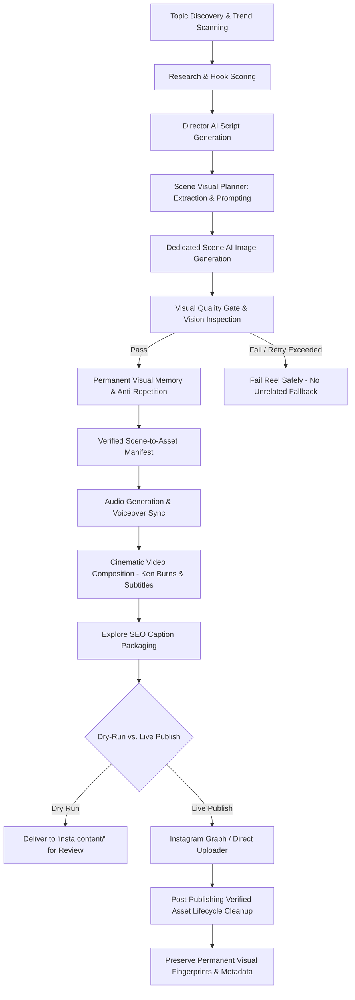

# VISUAL PIPELINE ARCHITECTURE MAP

**Repository:** `https://github.com/krishnashisbiswal/insta-agent`  
**Branch:** `feature/audit-repair-optimize`  
**Date:** 2026-11-16  

---

## 1. End-to-End Autonomous Reel Execution Flow

---

## 2. Component Mapping & Responsibility Breakdown

| Stage | Responsible Module / Class | Inputs | Outputs | Enforcement Rules |
|---|---|---|---|---|
| **1. Topic Discovery** | `TrendDiscoveryEngine` | Niche profile, historical performance, fatigue scores | Hot viral topic string & pillar | Prevents repeating recent topics (7-day anti-fatigue). |
| **2. Script Generation** | `script_agent.py` (`generate_reel`) | Topic, language, target duration | Structured JSON script with 5-7 scenes (`spoken_line`, `on_screen_text`, `badge`, `visual_description`) | 100% Devanagari Hindi for voiceover; ASCII English for cards. Scene-specific narrative development. |
| **3. Scene Visual Planning** | `SceneVisualPlanner` (Consolidated) | Scene dictionary (`spoken_line`, `on_screen_text`, `visual_description`), Topic (context only) | `SceneVisualPlan`: Primary subject, secondary subject, action, setting, prompt, exclusions | Context separation: Topic does NOT override scene entities. Word-boundary token matching. |
| **4. Fresh Image Generation** | `AIImageGenerator` | `SceneVisualPlan.prompt`, dimensions (1080x1920), seed, job ID | High-resolution vertical image file (`.jpg`) | Fresh unique generation per scene. Unique seed and job ID. Zero static list selection. |
| **5. Visual Quality Gate** | `VisionQualityGate` | Image bytes / path, `SceneVisualPlan` criteria | `VisualValidationReport`: relevance score, duplicate flag, pass/fail | Rejects corrupted images, wrong aspect ratio, near-duplicates, or mismatched subjects. |
| **6. Permanent Visual Memory** | `PermanentVisualMemory` | Image file / bytes, scene metadata | Fingerprint record (SHA-256, pHash, dHash, aHash, color embedding) | Durable atomic JSON persistence with file locks. Prevents cross-reel visual repetition. |
| **7. Manifest Assembly** | `SceneManifestBuilder` | List of validated scene assets & plans | Verified `SceneAssetManifest` | Strictly 1 verified image per scene. Zero duplicate hashes within the reel. |
| **8. Voiceover & Audio** | `tts_engine.py`, `smart_voice_router.py` | Spoken lines, voice model | Scene audio WAVs and mixed soundtrack | Neural TTS pronunciation optimization; sub-bass impact + tanpura drone. |
| **9. Cinematic Composition** | `cinematic_composer.py` | Verified `SceneAssetManifest`, scene audios | Rendered MP4 (`1080x1920`, 9:16 vertical) | Consumes ONLY manifest assets. Ken Burns camera motion, kinetic 2-beat subtitles. Truthful metadata. |
| **10. Post-Publishing Cleanup** | `AssetLifecycleManager` | Published job ID, confirmation evidence | Reclaimed disk space report | Cleans intermediate frames and temp files. **NEVER deletes permanent visual fingerprints**. |

---

## 3. The Broken Path vs. The Corrected Path

### The Broken Legacy Path
1. Scene 1 was forced into a gemstone macro image regardless of narration.
2. The Reel topic was combined with every scene, contaminating Scene 2, 3, 4 with the topic's entity.
3. Substrings like `"fire"`, `"love"`, `"wealth"` triggered arbitrary planetary images (`Mars`, `Venus`, `Jupiter`).
4. `generate_fresh_ai_visual()` in `SemanticVisualRouter` was bypassed completely.
5. If no keyword hit, fixed fallback arrays (`2_kundli_chart.jpg`, `planet_saturn.jpg`, etc.) were assigned modulo `scene_idx % len(queries)`.
6. No visual verification gate existed to reject bad images.
7. Uncurated scraping returned random public-domain photos (tacos, beetles).

### The Corrected Production Path
1. **Context Isolation:** Reel topic is marked as background context; scene visual entities are extracted exclusively from the scene's own `spoken_line`, `on_screen_text`, and `visual_description`.
2. **Dedicated Scene Prompts:** Every scene plans an explicit primary subject, action, environment, and required objects.
3. **Genuine Generation Provider:** Every scene invokes the AI image generation provider with its dedicated prompt and unique seed.
4. **Visual Quality Gate:** Image dimensions, formatting, and semantic consistency are verified before video editing.
5. **Verified Manifest:** Video composer consumes only pre-verified manifest assets matching scene order.
6. **Zero Repetition & Permanent History:** Every verified image is hashed (SHA-256, pHash, dHash) and durable recorded in `PermanentVisualMemory`. Temporary file cleanup preserves all fingerprints indefinitely.
