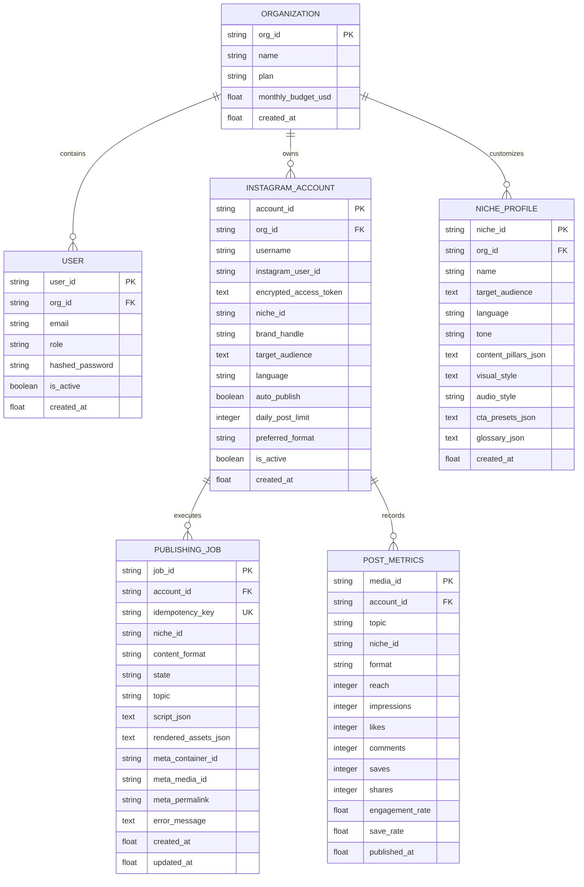

# Insta-Agent: Database Architecture & Design Specification

## 1. Overview

The storage architecture of Insta-Agent is designed for high-concurrency multi-tenant SaaS workloads. Built with SQLAlchemy 2.0 ORM, it natively supports both local SQLite (for embedded development and testing) and production PostgreSQL with connection pooling.

---

## 2. Entity-Relationship Model

---

## 3. Security & Indexing Strategy

1. **Idempotency Index**:
   - `publishing_jobs.idempotency_key` carries a unique constraint. Any concurrent attempt to insert an identical content hash fails with `DuplicateJobError`.
2. **Account & State Query Composite Index**:
   - `Index("idx_account_state", "account_id", "state")` accelerates frequent queue and status inspection queries.
3. **Encrypted Token Protection**:
   - `encrypted_access_token` is handled through transparent ORM accessors (`set_access_token` and `get_access_token`) ensuring raw OAuth keys are never exposed in SQL queries or logs.
