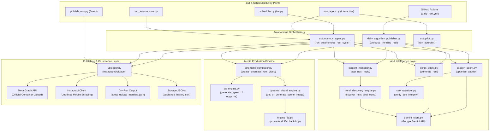

# System Execution Graph & Control Flows

**Audit Date**: November 10, 2026  
**Baseline Commit**: `e001e1473d27edaf0894226ae69230f488f11915`  

---

## 1. Primary Entry Points & Execution Paths

---

## 2. Identified Breakage Points in Current Graph

1. **Dual Orchestration Paths**: `autonomous_agent.py` and `daily_algorithm_publisher.py` duplicate ~80% of orchestration logic but with slight variations in error handling and metadata schemas.
2. **Fatal Failure in DAP**: In `daily_algorithm_publisher.py`, line 230 throws `NameError: playbook is not defined`. This stops the flow before `IU.upload_reel()` is invoked.
3. **Unprotected Publishing Entry**: `publish_now.py` bypasses `content_manager.py` and `published_history.json`, causing untracked external uploads.
4. **No Retry Queue**: If `CC` fails due to FFmpeg or memory issues, the topic in `CM` has already been popped and is lost from the queue.
5. **No Graph API Status Polling**: In `uploader.py`, `upload_reel_resumable()` uploads the video bytes to Meta's container but fails to implement a status polling loop (`status_code == 'FINISHED'`), prematurely declaring success before Meta processes the video.
