# Insta-Agent: Security Threat Model (STRIDE Methodology)

## 1. Overview

This document analyzes security risks, threat vectors, and corresponding engineering mitigations across the Insta-Agent SaaS architecture using the STRIDE threat categorization model.

---

## 2. Threat Analysis & Mitigations

| Threat Category | Potential Attack Vector | Severity | Engineering Mitigation Implemented |
| :--- | :--- | :--- | :--- |
| **Spoofing** | Forging account ownership or impersonating an Instagram user. | Critical | Organization-level tenant isolation; user-account foreign key constraints; OAuth token verification via Meta API. |
| **Tampering** | Altering publishing job payloads or injecting malicious script instructions. | High | Strict Pydantic validation schemas on all REST inputs; regex sanitation of code fences; isolated parameterization. |
| **Repudiation** | Claiming a post was published without authorization. | High | Authoritative `PublishingStateMachine` audit trail logging timestamp, state, actor, and container IDs for every transition. |
| **Information Disclosure** | Leakage of Instagram access tokens, session cookies, or API keys in databases, git commits, or logs. | Critical | AES-128-CBC encryption at rest via `cryptography.fernet`; zero credentials in version control; sanitized logging. |
| **Denial of Service** | Exhausting rate limits, memory, or storage via concurrent bulk generation. | Medium | Daily posting limits per account; persistent file locks; explicit MoviePy clip closures (`try/finally`). |
| **Elevation of Privilege** | Cross-tenant access to another organization's publishing queue or accounts. | Critical | Every database query filters by `org_id` and `account_id`; strict authorization barriers in FastAPI routers. |

---

## 3. Cryptographic Token Lifecycle

```mermaid
sequenceDiagram
    participant User as Client / User
    participant API as FastAPI Router
    participant Enc as Fernet TokenEncryptor
    participant DB as PostgreSQL Database
    participant Meta as Meta Graph API

    User->>API: POST /api/accounts (Token: EAAB...)
    API->>Enc: encrypt_token("EAAB...")
    Enc-->>API: Ciphertext ("gAAAAAB...")
    API->>DB: INSERT into instagram_accounts (encrypted_access_token)
    Note over DB: Plaintext token is NEVER saved to disk or DB

    rect rgb(20, 30, 40)
    Note over API,Meta: During Scheduled Publishing
    API->>DB: Fetch account record
    DB-->>API: Ciphertext ("gAAAAAB...")
    API->>Enc: decrypt_token(ciphertext)
    Enc-->>API: Plaintext token ("EAAB...")
    API->>Meta: POST /media (Authorization: OAuth EAAB...)
    end
```

