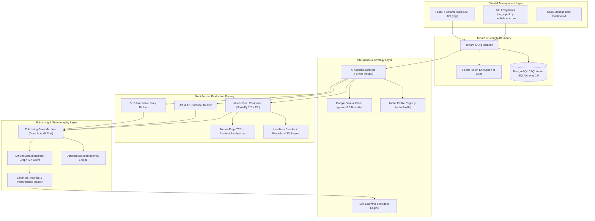

# Insta-Agent: System Architecture Specification

## 1. Executive Overview

Insta-Agent is a commercial-grade, multi-tenant Instagram AI content generation and automated publishing platform. It transforms manual creator workflows into an autonomous production line capable of generating and scheduling high-retention Instagram Reels, Carousels, Stories, and Single Posts across arbitrary niches (Technology, Fitness, Finance, Education, Astrology, and Custom Domains).

---

## 2. Core Architectural Pillars

---

## 3. Layer Breakdown

### 3.1 Tenant & Security Boundary
- **Multi-Tenant Isolation**: Every organization (`Organization`) owns independent accounts (`InstagramAccount`), jobs, usage limits, and budgets. Cross-tenant access is structurally prevented at the database session and query level.
- **Cryptographic Security**: Access tokens and sensitive session credentials are encrypted at rest using AES-128-CBC with HMAC-SHA256 authentication via `cryptography.fernet`. Raw tokens are never written to disk or logs in plaintext.

### 3.2 Strategy & Intelligence Layer
- **Niche Independence**: The core engine contains zero hardcoded niche assumptions. All copywriting, pacing, visual themes, color palettes, and calls-to-action are driven by dynamic `NicheProfile` configurations.
- **AI Creative Director**: Rather than forcing all concepts into video Reels, the Creative Director evaluates topic complexity, objective, and retention dynamics to select the optimal format:
  - **Reel**: High-tempo contrarian narratives, dramatic traits, audio-visual engagement.
  - **Carousel**: Step-by-step guides, educational slides, cheat sheets, frameworks.
  - **Story**: Real-time polls, Q&A quizzes, flash announcements, interactive stickers.
  - **Post**: High-impact quote cards, infographics, stat highlights.

### 3.3 Media Production Factory
- **Kinetic Reel Composer**: Assembles 9:16 vertical MP4s with clean typography, non-overlapping category badges, configurable brand watermarks, and synchronized vocal tracks. MoviePy clip lifecycles are wrapped in `try/finally` constructs with explicit resource teardown to prevent memory leaks and file locks on Windows and Linux.
- **Carousel & Story Builders**: Standalone PIL-based image renderers outputting publication-grade 1080x1350 and 1080x1920 assets with exact Instagram UI safe-zone margins.
- **3D & AI Video Interface**: Headless Blender detection (`blender -b -P`) with seamless fallback to procedural 3D numpy rendering or photorealistic Ken Burns compositing. Third-party video APIs (Runway, Luma) are encapsulated behind standard provider interfaces that honestly report `BLOCKED` status when credentials are unconfigured.

### 3.4 Publishing & State Integrity Layer
- **State Machine**: 13-state lifecycle (`CREATED`, `QUEUED`, `GENERATING`, `RENDERING`, `QUALITY_CHECK`, `READY`, `SCHEDULED`, `UPLOADING`, `PROCESSING`, `PUBLISHED`, `FAILED`, `CANCELLED`, `DRY_RUN`) with strict transition validation and persistent audit trails.
- **Idempotency Guard**: Content hashes derived from `account_id:niche_id:topic:format` prevent duplicate generation and concurrent double-posting.
- **Official Meta Graph API**: Resumable binary chunked video upload, container polling loops with exponential backoff, multi-item container carousels, and verified permalink retrieval.
